<div align="center">


[](https://github.com/NetCore-Technologies/AXIOM-AI)
[](https://github.com/NetCore-Technologies/AXIOM-AI/releases)
[](LICENSE)
[](https://www.python.org/)

# AXIOM AI

Check your model, data, and computer before you start. AXIOM gives you practical local checks from the terminal or a browser window on your computer.

[Get started](#get-started) · [What you can do](#what-you-can-do) · [Documentation](#documentation) · [Report an issue](https://github.com/NetCore-Technologies/AXIOM-AI/issues)



</div>

## What AXIOM does

- **Check a model folder** to see which files and details AXIOM can find.
- **Check training data** for invalid JSONL rows, missing fields, and duplicates.
- **See your computer’s hardware** and estimate whether a model may fit.
- **Plan a training run** or start local LoRA fine-tuning when you install the optional training tools.
- **Try local text generation** through Ollama.

AXIOM is still in beta. Plans are estimates; actual results depend on your model, data, and hardware. Your files stay on your computer for local checks. Features that use a remote service tell you when they need a network connection.

## Get started

Install the beta from PyPI:

```bash
python -m pip install --upgrade --pre axiom-all
axiom version
```

Create a project and run a few checks:

```bash
axiom init my-ai
cd my-ai
axiom project validate
axiom system info
axiom train plan 7 --method qlora
```

The training command makes a plan; it does not start a job. For the browser interface, run:

```bash
axiom gui
```

AXIOM opens its Control Center in your browser and serves it from your computer. Press `Ctrl-C` in the terminal to stop it.

## Install

### Debian, Ubuntu, or Linux Mint

The APT package is for 64-bit Intel and AMD systems:

```bash
curl -fsSLo /tmp/axiom-archive-keyring.gpg https://netcore-technologies.github.io/AXIOM-AI/apt/axiom-archive-keyring.gpg
sudo install -Dm0644 /tmp/axiom-archive-keyring.gpg /usr/share/keyrings/axiom-archive-keyring.gpg
echo 'deb [arch=amd64 signed-by=/usr/share/keyrings/axiom-archive-keyring.gpg] https://netcore-technologies.github.io/AXIOM-AI/apt stable main' | sudo tee /etc/apt/sources.list.d/axiom.list
sudo apt update
sudo apt install axiom-ai
```

### macOS or Linux

```bash
curl -fsSL https://raw.githubusercontent.com/NetCore-Technologies/AXIOM-AI/main/installers/install.sh | bash
axiom version
```

The installer puts `axiom` in `~/.local/bin`. If the command isn’t found, add that folder to your `PATH` and reopen your terminal.

### Windows

In PowerShell:

```powershell
irm https://raw.githubusercontent.com/NetCore-Technologies/AXIOM-AI/main/installers/install.ps1 | iex
axiom version
```

If PowerShell can’t find `axiom`, close and reopen it so the updated `PATH` takes effect.

For package downloads and checksums, see [GitHub Releases](https://github.com/NetCore-Technologies/AXIOM-AI/releases).

## What you can do

| To… | Run… |
| --- | --- |
| Check a model folder | `axiom model inspect ./models/my-model` |
| Check a JSONL dataset | `axiom dataset validate ./data/train.jsonl` |
| See your hardware | `axiom system info` |
| Make a training plan | `axiom train plan 7 --method qlora` |
| Check your project setup | `axiom doctor` |
| See available commands | `axiom --help` |

The **Models** page supports server-side search, exact format/tag filters, favorites-only views, numeric parameter sorting, filtered pagination, and browser-local saved filter presets. Model entries also expose estimated RAM/VRAM fit ranges and explicit compatibility warnings when enough metadata is available. See the [Model Registry guide](docs/Model-Registry.md).

## Optional features

### Local fine-tuning

AXIOM can run LoRA fine-tuning on a model that is already on your computer. Install the optional dependencies first:

```bash
python -m pip install -e '.[training]'
axiom train run --model-path ./models/my-model --dataset ./data/train.jsonl --output-dir ./runs/my-adapter --max-steps 20
```

See the [fine-tuning guide](docs/Local-Fine-Tuning.md) for supported data, limits, and setup.

### Local text generation

Install and start [Ollama](https://ollama.com/), then check its status and available models:

```bash
axiom infer status
axiom infer models
axiom infer run qwen2.5:0.5b --prompt "Say hello in one sentence."
```

### AXIOM Engine (direct local inference)

The Control Center's **AXIOM Local Engine** loads a compatible local Transformers causal-language-model checkpoint directly, with optional LoRA adapters. It uses AXIOM's own bounded runtime and does not require Ollama for this path. It never downloads model weights or executes remote model code. The runtime and LoRA training loop are AXIOM-owned; pretrained base weights are still supplied separately by you.

Install the local model dependencies, then use the AXIOM Engine panel in the Control Center:

```bash
python -m pip install -e '.[training]'
```

Use the CLI or the Control Center panel to run it:

```bash
axiom --no-banner engine status
axiom --no-banner engine run --model-path "$HOME/models/my-llama-model" --prompt "Explain AXIOM in one sentence." --max-new-tokens 128
```

See [AXIOM Engine details](docs/Local-Engine.md) for local model layout, adapter use, and limits.

### Model Studio

Model Studio helps you search for models, install them in Ollama, and convert local models to GGUF. Some options need a network connection or a local `llama.cpp` checkout. See the [Model Studio guide](docs/Model-Studio.md).

## Your data and local API

Local checks run on your computer. AXIOM does not upload your model weights or datasets for these checks. Commands that look up remote model details or connect to a provider need network access.

The local API and Control Center use loopback addresses by default. The optional support bundle contains diagnostic details; review it before sharing. See [API details](docs/API.md) and [support-bundle contents](docs/Diagnostics-and-Support.md).

## Documentation

- [Install and troubleshooting](https://github.com/NetCore-Technologies/AXIOM-AI/wiki)
- [Changelog](docs/CHANGELOG.md)
- [Local fine-tuning](docs/Local-Fine-Tuning.md)
- [Model Studio](docs/Model-Studio.md)
- [Model Registry](docs/Model-Registry.md)
- [Local inference via Ollama](docs/Local-Inference.md)
- [AXIOM Engine](docs/Local-Engine.md)
- [API](docs/API.md)
- [Roadmap](ROADMAP.md)
- [Community and adoption strategy](docs/Community-and-Adoption-Strategy.md)
- [Contributing](CONTRIBUTING.md)

## Contributing

Bug reports are easiest to fix when they include your OS, Python version, AXIOM version, and the command you ran. Don’t attach API keys, private datasets, or model weights.

To work on AXIOM locally:

```bash
python -m pytest -q
npm run lint
npm run build
npm run e2e
```

## License

AXIOM is available under the [MIT License](LICENSE).
