<div align="center">


[](https://github.com/NetCore-Technologies/AXIOM-AI)
[](https://github.com/NetCore-Technologies/AXIOM-AI/releases)
[](LICENSE)
[](https://www.python.org/)
[](https://github.com/NetCore-Technologies/AXIOM-AI/releases)

**Know your model, your data, and your machine before you spend a single GPU hour.**

[Quick start](#-quick-start) ·
[Install](#-install) ·
[Commands](#-commands-by-job) ·
[Website](https://netcore-technologies.github.io/AXIOM-AI/) ·
[Contributing](CONTRIBUTING.md)


<sub>Sample output. Plans and estimates are not benchmark results. See the [Web UI](#%EF%B8%8F-web-ui) below.</sub>

</div>

## What is AXIOM?

AXIOM is a local-first CLI for answering the questions that come before a
local AI job:

- What is in this model directory?
- Is this JSONL dataset structurally usable?
- What hardware is available on this machine?
- What is a reasonable starting plan?

It inspects local files, keeps small amounts of project metadata, reports what
is available on the current machine, and suggests the next command. The
terminal is the product. The optional daemon exposes the same local context as
small JSON responses on a loopback address.

Project configuration lives in `axiom.yaml`; the local model registry lives in
`.axiom`. Core inspection and planning do not require an AXIOM account.

> AXIOM does not execute training, run model inference, or provide a hosted
> workspace. Estimates and plans are labeled as estimates and plans.

## What is new in v0.3.0-beta.4

This beta focuses on making the existing local-first workflows easier to discover, inspect, validate, and support:

- **Module Explorer:** discover GUI pages, CLI command families, and API surfaces from the Control Center.
- **Workspace diagnostics:** run `axiom doctor` or `axiom doctor --json` for structured, read-only checks of workspace configuration, filesystem access, disk space, Python compatibility, and required imports.
- **Roadmap auditing:** run `axiom roadmap audit --json` to check the scoped 120-item roadmap for missing, duplicate, unexpected, or unknown IDs/statuses; the Control Center also exposes the roadmap view.
- **Support bundles:** generate a privacy-minimized bundle with `axiom support-bundle --output ./axiom-support-bundle.zip`. Inspect the archive before sharing it.
- **Read-only API Playground:** a fixed GET-only endpoint allowlist, bounded requests, and capped response previews; arbitrary URLs and mutating methods are not supported.
- **Workflow design management:** templates, versioned saves, duplication, revision history, validation, and dry-run resource estimates.
- **Control Center usability:** improved local navigation and remembered administrator sessions, plus more consistent API errors and request correlation.

### Execution boundary

AXIOM's core remains a local-first inspection, validation, and planning tool. A workflow validation or dry run is **not** a training run, inference session, checkpoint manager, or production model server. Use a supported external runtime/framework for execution; AXIOM must not imply that a backend is installed or connected unless it has actually detected and verified it.

### Release verification

The `v0.3.0-beta.4` tag is a beta release candidate, not a claim that every planned roadmap item is complete. Check the [release page](https://github.com/NetCore-Technologies/AXIOM-AI/releases/tag/v0.3.0-beta.4) and [Actions](https://github.com/NetCore-Technologies/AXIOM-AI/actions/workflows/release-assets.yml) for the published artifacts and build status.

## 🚀 Quick start

Do these in order. Each step is one command.

1. Install AXIOM (see [Install](#-install)), then confirm it works:

   ```bash
   axiom version
   ```

2. Get oriented. None of these start the daemon:

   ```bash
   axiom --help
   axiom guide
   axiom summary
   ```

3. Create a project and check it:

   ```bash
   axiom init my-ai
   cd my-ai
   axiom project validate
   axiom config validate
   ```

4. Look at your machine:

   ```bash
   axiom system info
   ```

5. Get a starting plan for a 7B model:

   ```bash
   axiom train plan 7 --method qlora
   ```

Want the interactive mode? Run bare `axiom`. In an interactive terminal it
prints the startup mark once per session, shows the useful command path,
starts the local daemon on a free port, and stays attached until Ctrl-C.
To open the graphical Control Center with the workspace API, run `axiom gui`;
`axiom ui` is an alias. Both services bind to loopback and stop with Ctrl-C.
The local API contract and compatibility policy are documented at
[`docs/API.md`](docs/API.md); the live OpenAPI document is served at
`/api/openapi.json` while the daemon runs.
Saved training-plan snapshots are available in the GUI history and with
`axiom experiment list` or `axiom experiment show <id>`; they are plans, not
executed runs.
To save an exact CLI plan snapshot, add `--save`; `--json` emits the plan and
saved record for scripts:

```bash
axiom train plan 7 --method qlora --save --name "7B baseline" --tag baseline --json
```
Saved GUI workflow designs can be inspected and structurally validated from the
same workspace store with `axiom workflow list`, `axiom workflow show <id>`,
and `axiom workflow validate <id>`. These commands do not execute workflow steps.
`axiom evaluation run ./data/eval.jsonl --prediction-field prediction --reference-field reference`
scores precomputed outputs locally without model inference; see [the evaluation guide](docs/Evaluation.md) for metric definitions.

## 🧭 First 10 minutes

Pick the path that matches what you have in front of you.

| I have... | Run this | You get |
| --- | --- | --- |
| A local model folder | `axiom model inspect ./models/my-model` | Format, files, architecture hints, weight size, conservative fit info. |
| A model name on Hugging Face | `axiom model info org/model` | Published metadata without downloading weights. Needs network. |
| A JSONL dataset | `axiom dataset validate ./data/train.jsonl` | Invalid records and duplicates; exits non-zero if records are invalid. |
| A dataset I want sized up | `axiom dataset stats ./data/train.jsonl` | Record, field, and rough token counts. |
| A messy dataset | `axiom dataset clean ./data/train.jsonl ./data/train.cleaned.jsonl` | A new cleaned file; the source is left unchanged. |
| A new machine | `axiom system info` | OS, architecture, CPU, RAM, GPU, VRAM, CUDA availability. |
| A plan to make | `axiom train plan 7 --method qlora` | Hardware-aware starting plan. It does not start training. |
| Some dev tools installed | `axiom tools doctor` | Executable and credential-reference presence, not vendor login state. |

## 📦 Install

### Debian / Ubuntu / Linux Mint (APT, amd64)

AXIOM publishes a signed APT repository alongside the project website. Add its public key and repository, then install the `axiom-ai` package:

```bash
curl -fsSLo /tmp/axiom-archive-keyring.gpg https://netcore-technologies.github.io/AXIOM-AI/apt/axiom-archive-keyring.gpg
sudo install -Dm0644 /tmp/axiom-archive-keyring.gpg /usr/share/keyrings/axiom-archive-keyring.gpg
echo 'deb [arch=amd64 signed-by=/usr/share/keyrings/axiom-archive-keyring.gpg] https://netcore-technologies.github.io/AXIOM-AI/apt stable main' | sudo tee /etc/apt/sources.list.d/axiom.list
sudo apt update
sudo apt install axiom-ai
```

The APT package currently targets 64-bit Intel/AMD (`amd64`). The repository metadata and release signature are verified by APT using the dedicated public keyring.

### PyPI

The beta package installs the `axiom` command from PyPI:

```bash
python -m pip install --upgrade --pre axiom-all
axiom version
```

`axiom-all` is the distribution name; the installed command is `axiom`.
Stable releases can be installed without `--pre` once one is published.

### macOS and Linux

<!-- markdownlint-disable MD013 -->
```bash
curl -fsSL https://raw.githubusercontent.com/NetCore-Technologies/AXIOM-AI/main/installers/install.sh | bash
axiom version
```
<!-- markdownlint-enable MD013 -->

The installer puts the command in `~/.local/bin/axiom`.

- Linux x86_64 uses the latest published `linux-x64` tarball and verifies its
  entry in `SHA256SUMS` before activation. The unpacked bundle is the faster
  repeated-start path.
- macOS and non-x86 Linux use an isolated Python environment and install from
  the repository's `main` branch. This fallback requires Python 3.11+ and is a
  source install, not a pinned native binary.

If `~/.local/bin` is not on `PATH`, the installer prints the export command.
Open a new shell after adding it.

### Windows PowerShell

<!-- markdownlint-disable MD013 -->
```powershell
irm https://raw.githubusercontent.com/NetCore-Technologies/AXIOM-AI/main/installers/install.ps1 | iex
```
<!-- markdownlint-enable MD013 -->

The installer downloads the latest non-draft Windows x64 release to
`%LOCALAPPDATA%\AXIOM`, adds that directory to the user `PATH`, and asks you to
restart PowerShell. Verify with:

```powershell
axiom version
```

Check the [Releases page](https://github.com/NetCore-Technologies/AXIOM-AI/releases)
for the exact assets and checksums available for a release.

## 🔌 The daemon boundary

Run the daemon by itself when a script or local integration needs HTTP:

```bash
axiom daemon --host 127.0.0.1 --port 0
```

Port `0` asks the operating system for an available port. AXIOM prints the
resulting loopback URL, such as `http://127.0.0.1:53142`. While that process is
running, the daemon provides read-only JSON routes:

```text
GET /health
GET /api/info
GET /api/summary
GET /api/actions
GET /api/hardware
GET /api/tools
```

The default bind is local-only. A non-loopback bind is rejected unless
`--allow-network` is supplied deliberately. The daemon is not an account
service, hosted AXIOM backend, or general inference server. Stop it with
Ctrl-C.

## 🖥️ Web UI

The release packages and the PyPI wheel bundle the web UI. Run `axiom gui` to
start the workspace API and open the Control Center in your browser. Use
`axiom gui --no-open` to print the local URL without opening a browser. The
separate `axiom daemon` command remains available for the read-only JSON API.

<div align="center">



<sub>Sample data. Sizes and plans are estimates, not benchmark results.</sub>

</div>

- **Quantization Lab** compares FP16, INT8 and INT4 size estimates against the
  memory AXIOM detects, so you can see what fits before you download anything.
- **Optimizer** turns that into a conservative starting plan.

## 🛠️ Commands by job

### Project and environment

```bash
axiom version
axiom guide
axiom summary
axiom summary --json
axiom info
axiom status
axiom doctor
```

`guide` explains the current directory and suggests safe next commands.
`summary` returns a read-only snapshot of the project, hardware, visible tools,
and one recommendation; `--json` is intended for scripts. `doctor` checks
common executables and AXIOM package metadata.

### Models

```bash
axiom model list
axiom model add my-model local safetensors
axiom model inspect ./models/my-model
axiom model search llama --path models
axiom model info org/model
axiom model analyze org/model
axiom model pull org/model
```

The first three local commands do not need network access. Hugging Face
metadata and pull commands do; private or gated repositories also need
`axiom hf login`. `model pull` performs disk checks before downloading.

### Datasets

```bash
axiom dataset inspect ./data/train.jsonl
axiom dataset validate ./data/train.jsonl
axiom dataset stats ./data/train.jsonl
axiom dataset clean ./data/train.jsonl ./data/train.cleaned.jsonl
axiom dataset profile ./data/train.jsonl --duplicate-key id --duplicate-rate-threshold 0.05 --text-fields prompt,completion
axiom dataset profile ./data/train.jsonl --scan-pii
axiom dataset manifest ./data/train.jsonl
axiom dataset manifest ./data/derived.jsonl --parent-manifest-sha256 <source-sha256>
axiom dataset preview-clean ./data/train.jsonl
```

The current dataset path supports `.jsonl`. Validation checks JSON objects and
duplicates; it does not establish semantic quality or training readiness.
Bounded profiling reports UTF-8/newline/malformed-record diagnostics, configurable
duplicate-key rates, aggregate whitespace-token length bins, and sensitive-field
name warnings. Optional `--sensitive-rule` values add substring rules, while
`--ignore-sensitive-field` excludes exact names to manage false positives. Reports
contain structural counts and field names only; they never contain row values.
PII pattern checks are off unless `--scan-pii` is supplied (or the GUI opt-in is
checked); their email, phone-like, and Luhn-valid card matches are heuristics, not
a guarantee. `dataset manifest` hashes at most the configured limit and labels
prefix hashes partial; `--parent-manifest-sha256` links a derived dataset to its
source manifest. `dataset preview-clean` reports removal/normalization counts
without writing any file; `dataset clean` remains a separate explicit command.

### Hardware and planning

```bash
axiom system info
axiom train plan 7 --method auto
axiom train plan 7 --method lora
axiom train plan 7 --method qlora
axiom train plan 7 --method full
axiom ai plan --model ./models/my-model
```

The planner uses detected hardware and conservative assumptions. Its fit and
VRAM values are planning estimates, not measured speed, memory usage, or a
promise that a later runtime will succeed.

### Experiment plans

```bash
axiom experiment list --query baseline --tag review --json
axiom experiment show <experiment-id>
axiom experiment update <experiment-id> --name "Reviewed plan" --tag baseline --tag approved
axiom experiment delete <experiment-id> --yes
```

Experiment records are immutable plan snapshots with separately editable names,
notes, and tags. Search, exact-tag filtering, and pagination are available in
the Control Center and CLI. Deleting a record does not delete model or dataset
files; AXIOM does not yet create run artifacts.

### Developer tools

```bash
axiom tools list
axiom tools list --json
axiom tools doctor
axiom tools plan opencode
axiom tools install opencode       # preview only
axiom tools install opencode --yes # explicit package-manager install
```

The catalog covers Codex, Claude Code, Antigravity CLI, GitHub Copilot CLI,
Freebuff, Cursor Agent, free-pi, OpenCode, Gemini, OpenRouter, z.ai GLM, and a
keep-awake helper. `tools list` and `tools doctor` observe the current machine;
they do not prove that a vendor account is authenticated. Installation is a
preview unless `--yes` is supplied. AXIOM does not silently execute remote
installer scripts or store API-key values.

[Headroom](https://github.com/headroomlabs-ai/headroom) is a separate,
optional local context-compression proxy. If it is installed independently,
its own command path is:

```bash
headroom doctor
headroom proxy
headroom dashboard
```

AXIOM's role is limited to discovering or explaining Headroom. It does not
bundle, install, start, or supervise it; only the user starts the proxy or
dashboard. Do not read the integration as a promise of savings or a measured
result.

### MCP

Start the local stdio server from an MCP client configuration:

```bash
axiom mcp serve
```

It exposes local model, dataset, hardware, training-plan, and optional
SuperCompress tools as a process. It is separate from the HTTP daemon.
MCP tools are denied by default. Inspect the active policy, explicitly grant
only the tools you need, or create and select a named profile:

```bash
axiom mcp permissions
axiom mcp allow axiom_system_info --profile default
axiom mcp profile create read-only
axiom mcp allow axiom_model_list --profile read-only
axiom mcp profile use read-only
```

The Control Center also edits those same local profiles. Dataset profiling in
the GUI offers quick, standard, and deep bounded scan budgets; profile results
include the effective limits. The dataset quality panel compares schemas
across two or three files, checks required fields and expected JSON types, and
downloads a values-free JSON report. It also exposes encoding/newline diagnostics,
duplicate-key thresholds, token-length bins, and configurable privacy-name rules.
PII scanning is an explicit opt-in and returns only category/field counts. Dataset
manifests support full/partial checksums and parent-hash lineage links; cleaning previews never write
files; the actual cleaner remains a separate CLI operation. Dataset reports exist
only in the current GUI session and the page's Clear reports action removes them.
Its Workflows page validates and saves
versioned local graph designs, includes templates and revision history, and
supports duplication. Saved workflows can be dry-run for resource estimates and
an exportable software/seed manifest; all steps remain marked not-run and no job
is created because workflow execution is not available. Existing saved designs
autosave after edits by default (with a GUI toggle); new designs still require an
explicit save.

The Models page supports local-folder discovery under `models/`, bounded
inspection summaries, stable registry IDs, tags, favorites, pagination, and
versioned JSON import/export. Removing an entry removes only registry metadata;
it never deletes model weights.

## Read-only API Playground, runtime discovery and agent profiles

The Control Center's API Playground exposes a small allowlist of `GET` endpoints only. It uses the shared 15-second API timeout, bounded inventory reads, and a capped JSON preview; it does not accept arbitrary URLs, request bodies, or mutation methods. See [the Playground safety contract](docs/Api-Playground.md).

The Runtime page detects known local runtime executables and Python packages passively. It does not start processes, contact endpoints, load models, or certify readiness. See [runtime discovery semantics](docs/Runtime-Discovery.md).

Agent Profiles offers versioned task-intent labels and a default-deny profile stored locally in `.axiom/agent-profiles.json`. These labels are descriptive metadata only; MCP permissions remain enforced separately. See [the Agent Profiles contract](docs/Agent-Profiles.md).

Before a release, run `python scripts/release_smoke.py`, `python -m pytest -q`, `npm run lint`, `npm run build`, and `npm run e2e`. Static smoke checks complement but do not replace execution tests.

## ✅ What is shipped, and what is not

### Shipped in the beta

- A Python package and Typer CLI with a one-command local entry point.
- Project scaffolding, configuration checks, and local status/summary output.
- Model registration, local inspection, Hugging Face metadata analysis, and
  disk-checked model pulls.
- JSONL inspection, validation, duplicate detection, statistics, and cleaning.
- Hardware detection and hardware-aware LoRA, QLoRA, and full-training plans.
- A read-only loopback daemon with health, summary, action, hardware, and tool
  routes.
- MCP tools and an opt-in developer-tool catalog with preview-first installs.
- A static landing page that explains the terminal workflow.

### Not shipped by this product boundary

- Training execution, job management, checkpoints, or run/outcome tracking.
  The GUI stores planning snapshots only; it does not claim they were run.
- Model inference, production serving, streaming, batching, or an
  OpenAI-compatible server.
- Live telemetry, background monitoring, hosted workspaces, or accounts.

## 🗂️ Repository shape

```text
axiom/
├── cli/          Typer command surface
├── core/         Project, hardware, storage, and integration helpers
├── models/       Local registry, inspection, and metadata analysis
├── datasets/     JSONL inspection and cleaning
├── training/     Hardware-aware plan generation
├── optimizer/    Agent workload plans and runtime bundles
├── runtime/      Optional runtime integrations
├── daemon.py     Dependency-free loopback HTTP daemon
└── mcp/          Stdio MCP server and tools
```

The public website is intentionally static. Product work belongs in the CLI,
local daemon, and reproducible project files.

## 🧱 Principles

- **Local first:** keep models, datasets, configuration, and first-pass
  decisions close to the machine that will run them.
- **Evidence before execution:** expose assumptions before a user spends time
  or compute.
- **Explicit side effects:** preview external tool setup and require opt-in for
  package installation.
- **Honest boundaries:** separate detections, estimates, plans, and measured
  results.

## 🤝 Contributing

AXIOM is in active beta development. Bug fixes, tests, documentation, and
tooling improvements are welcome.

Read [CONTRIBUTING.md](CONTRIBUTING.md) before making a larger change.

## 📄 License

MIT. See [LICENSE](LICENSE).

Built by [Manit Arora](https://github.com/manit6752025) and
[Rangan V Balaji](https://github.com/TaxCollector23).

[Website](https://netcore-technologies.github.io/AXIOM-AI/)

## Module explorer, diagnostics, roadmap audit, and support bundles

The Control Center **Module Explorer** maps current GUI pages, CLI-only command families, and the live OpenAPI reference so capabilities are discoverable without pretending every command can safely run inside a browser. Run `axiom doctor --json` for machine-readable diagnostics, `axiom roadmap audit --json` to validate the 120 roadmap IDs and status roll-up, or `axiom support-bundle --output ./axiom-support-bundle.zip` to export a privacy-minimized support archive. The archive excludes configuration values, environment variables, credentials, model weights, datasets, logs, and absolute paths. The Control Center Roadmap page reads statuses directly from `ROADMAP.md`. Inspect support bundles before sharing. See [the diagnostics and support guide](docs/Diagnostics-and-Support.md).
