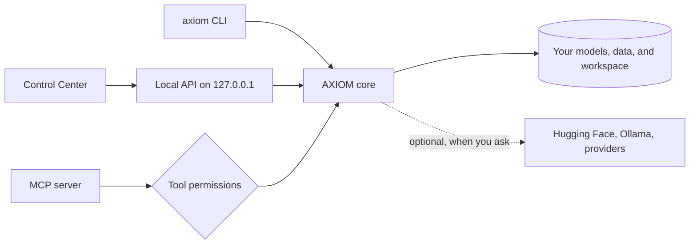

<div align="center">


[](https://github.com/manit6752025/AXIOM-AI)
[](https://github.com/manit6752025/AXIOM-AI/releases)
[](LICENSE)
[](https://www.python.org/)
[](#privacy-and-safety)
[](#mcp-server-for-ai-agents)

# AXIOM AI

**Check your model, data, and computer before you start.**
Inspect models, clean datasets, read your hardware, plan training, run local inference, and let AI agents use all of it safely. From a terminal, a browser window, or an MCP client.

[Quick start](#quick-start) · [Features](#feature-map) · [Control Center](#control-center) · [MCP](#mcp-server-for-ai-agents) · [Docs](#documentation) · [Report an issue](https://github.com/manit6752025/AXIOM-AI/issues)




</div>

## Why AXIOM

Most AI projects fail early for boring reasons: the model does not fit, the dataset has broken rows, or the setup is wrong. AXIOM catches those problems in seconds, on your own machine, before you spend hours of GPU time.

| Check | Plan | Act |
| --- | --- | --- |
| Inspect model folders and Hugging Face repos | Fit estimates for your RAM and VRAM | LoRA and QLoRA fine-tuning |
| Validate and clean JSONL datasets | Training plans you can save and compare | Local text generation with the AXIOM Engine or Ollama |
| Diagnose your workspace | Agent-specific optimization profiles | Score predictions and gate regressions |

AXIOM is in beta. Plans are estimates, and real results depend on your model, data, and hardware.

## Quick start

```bash
python -m pip install --upgrade --pre axiom-all
axiom version
axiom init my-ai
cd my-ai
axiom doctor
axiom system info
axiom train plan 7 --method qlora
axiom gui
```

| Step | Command | What you get |
| --- | --- | --- |
| 1 | `axiom init my-ai` | A starter project with `data`, `models`, `experiments`, `evaluations`, and `outputs` |
| 2 | `axiom doctor` | Pass, warn, or fail checks for your workspace and tools, with next steps |
| 3 | `axiom system info` | Your OS, CPU, RAM, GPU, VRAM, and model fit estimates |
| 4 | `axiom train plan 7 --method qlora` | A hardware-aware plan for a 7B model. No job is started |
| 5 | `axiom gui` | The Control Center, served from your own computer |

Not sure what to do next? Run `axiom guide`. It reads your current folder and suggests the next commands.

## Install

<details open>
<summary><b>pip (all platforms)</b></summary>

```bash
python -m pip install --upgrade --pre axiom-all
axiom version
```

</details>

<details>
<summary><b>Debian, Ubuntu, or Linux Mint</b></summary>

The APT package is for 64-bit Intel and AMD systems:

```bash
curl -fsSLo /tmp/axiom-archive-keyring.gpg https://manit6752025.github.io/AXIOM-AI/apt/axiom-archive-keyring.gpg
sudo install -Dm0644 /tmp/axiom-archive-keyring.gpg /usr/share/keyrings/axiom-archive-keyring.gpg
echo 'deb [arch=amd64 signed-by=/usr/share/keyrings/axiom-archive-keyring.gpg] https://manit6752025.github.io/AXIOM-AI/apt stable main' | sudo tee /etc/apt/sources.list.d/axiom.list
sudo apt update
sudo apt install axiom-ai
```

</details>

<details>
<summary><b>macOS or Linux installer</b></summary>

```bash
curl -fsSL https://raw.githubusercontent.com/manit6752025/AXIOM-AI/main/installers/install.sh | bash
axiom version
```

The installer puts `axiom` in `~/.local/bin`. If the command is not found, add that folder to your `PATH` and reopen your terminal.

</details>

<details>
<summary><b>Windows (PowerShell)</b></summary>

```powershell
irm https://raw.githubusercontent.com/manit6752025/AXIOM-AI/main/installers/install.ps1 | iex
axiom version
```

If PowerShell cannot find `axiom`, close and reopen it so the updated `PATH` takes effect.

</details>

Package downloads and checksums are on [GitHub Releases](https://github.com/manit6752025/AXIOM-AI/releases). Packaging recipes for APT, AUR, Homebrew, npm, Scoop, and WinGet live in [`packaging/`](packaging). More options: [installers/README.md](installers/README.md).

## Container images

AXIOM publishes verified OCI images through [GitHub Container Registry](https://github.com/manit6752025?tab=packages). The core image is multi-platform (Linux AMD64 and ARM64); separate inference, training, and combined full-extras images cover different dependency profiles.

```bash
docker pull ghcr.io/manit6752025/axiom-ai:latest
docker run --rm -p 127.0.0.1:8765:8765 ghcr.io/manit6752025/axiom-ai:latest
```

Open `http://127.0.0.1:8765/ui/` for the Control Center. For native inference, training, or both together, use `ghcr.io/manit6752025/axiom-ai-inference`, `ghcr.io/manit6752025/axiom-ai-training`, or `ghcr.io/manit6752025/axiom-ai-full`. See the [container image guide](docs/Container-Image.md) for exact tags, Compose setup, architectures, and security guidance.

## Feature map

| Area | What it does | Start with |
| --- | --- | --- |
| **Models** | Inspect local folders, analyze Hugging Face repos without downloading weights, keep a registry | `axiom model inspect ./models/my-model` |
| **Datasets** | Validate JSONL, find duplicates, estimate tokens, write a cleaned copy | `axiom dataset validate ./data/train.jsonl` |
| **Hardware** | Detect CPU, RAM, GPU, and VRAM, and estimate which model sizes fit | `axiom system info` |
| **Training** | Hardware-aware plans, saved experiment history, optional local LoRA fine-tuning | `axiom train plan 7 --method qlora` |
| **AXIOM Engine** | Direct local inference on PyTorch. No Ollama and no `model.generate` | `axiom engine status` |
| **Unified LLM client** | One local/cloud client for AXIOM Native Engine, Ollama (including GGUF via Ollama), OpenAI, Anthropic, Gemini, DeepSeek, Moonshot/Kimi, OpenRouter, and public OpenAI-compatible HTTPS endpoints | `axiom llm providers` |
| **Mobile-agent bridge** | Token-protected OpenAI-compatible endpoint for native AXIOM and local Ollama models in compatible mobile clients | `axiom mobile-bridge` |
| **Local Ollama operations** | Managed loopback service lifecycle, cancellable model pulls with progress, streamed token output with Stop/cancel, loaded-model RAM/VRAM inventory, model metadata inspection, and memory unload without deleting weights | `axiom infer service start`; `axiom infer pull`; `axiom infer ps`; `axiom infer inspect`; `axiom infer unload` |
| **Model Studio** | Search GGUF models, install them, convert local models to GGUF | `axiom model studio wizard` |
| **Agent Optimizer** | Eight workload profiles that pick quantization and build a runtime bundle | `axiom optimize profiles` |
| **Evaluation** | Score precomputed predictions offline and gate regressions against a baseline | `axiom evaluation run` |
| **MCP server** | Let AI agents call AXIOM tools with default-deny permissions | `axiom mcp serve` |
| **Developer tools** | Find and safely set up coding-agent CLIs and model APIs | `axiom tools list` |
| **Diagnostics** | Doctor, status, summary, and a privacy-safe support bundle | `axiom doctor` |
| **Control Center** | A browser interface for all of the above | `axiom gui` |

## Deep dives

<details>
<summary><b>Models and the registry</b></summary>

Check a local model folder for config, tokenizer, weight formats, parameter count, and estimated VRAM:

```bash
axiom model inspect ./models/my-model
axiom model inspect ./models/my-model --json
```

Look up a Hugging Face model without downloading any weights:

```bash
axiom model info Qwen/Qwen2.5-0.5B-Instruct
axiom model analyze Qwen/Qwen2.5-0.5B-Instruct
```

Download with a disk-space safety check. AXIOM blocks the download if it would not fit or would push disk usage past your limit:

```bash
axiom model pull Qwen/Qwen2.5-0.5B-Instruct --max-disk-usage 85
```

Keep a registry of the models you care about:

```bash
axiom model add my-model ./models/my-model --format safetensors --tag chat
axiom model list
axiom model favorite MODEL_ID
axiom model export --path models.registry.json
axiom model import models.registry.json
```

Sign in to Hugging Face for gated models with `axiom hf login`. Check it with `axiom hf status`. Your token is never printed.

More: [Model Registry guide](docs/Model-Registry.md).

</details>

<details>
<summary><b>Datasets</b></summary>

```bash
axiom dataset validate ./data/train.jsonl
axiom dataset stats ./data/train.jsonl
axiom dataset inspect ./data/train.jsonl
axiom dataset clean ./data/train.jsonl --output ./data/train.cleaned.jsonl
```

- `validate` exits with a non-zero code when it finds invalid rows, so it works as a CI gate.
- `clean` removes invalid, empty, duplicate, and non-object rows. Your original file is never changed.
- Token counts are rough estimates, not tokenizer measurements.

</details>

<details>
<summary><b>Training plans and experiment history</b></summary>

```bash
axiom train plan 7 --method qlora
axiom train plan 13 --method lora --save --name "13B LoRA" --tag baseline
axiom experiment list
axiom experiment show EXPERIMENT_ID
```

A plan gives you precision, LoRA rank, batch size, gradient accumulation, sequence length, learning rate, and an estimated VRAM fit. Saved plans are snapshots. Editing a name, note, or tag never changes the plan itself. Planning never starts a job.

</details>

<details>
<summary><b>Local fine-tuning (LoRA)</b></summary>

Install the optional training tools from a clone of this repo, then run a short job on a model already on your computer:

```bash
python -m pip install -e '.[training]'
axiom train run --model-path ./models/my-model --dataset ./data/train.jsonl --output-dir ./runs/my-adapter --max-steps 20
```

See the [fine-tuning guide](docs/Local-Fine-Tuning.md) for supported data, limits, and setup.

</details>

<details>
<summary><b>AXIOM Engine (direct local inference)</b></summary>

AXIOM owns this inference path. It runs Llama, Mistral, Qwen2, and Qwen3 text-decoder forward passes and an autoregressive KV-cache decoder on PyTorch tensor kernels: RMSNorm, RoPE, grouped-query attention, Qwen3 query/key RMS normalization, SwiGLU, and supported LoRA deltas. It does not call Ollama or Transformers `model.generate`. Select full-weight loading, in-RAM layer streaming with a CPU KV cache, or disk-resident layer streaming that reads a safetensors layer on demand and releases it after use. Both streaming modes trade throughput for lower memory use.

```bash
axiom --no-banner engine status
axiom --no-banner engine run --model-path "$HOME/models/my-llama-model" --prompt "Explain AXIOM in one sentence." --max-new-tokens 128
```

- Needs a local `tokenizer.json` and floating-point safetensors weights. GGUF, quantized weights, pickle `.bin` files, and unsupported architectures are rejected with a clear message.
- Pick a device with `--device`. AXIOM reports detected CPU, CUDA, ROCm, Metal, and XPU options.
- Pick `--precision auto|fp32|fp16|bf16`. Auto preserves the checkpoint dtype; FP16/BF16 may reduce memory for FP32 checkpoints where the backend supports them. This is floating-point precision, not INT8/INT4 quantization.
- Choose `--memory-mode layer_streaming` when accelerator memory is constrained. This is not quantization; native GGUF/EXL2/GPTQ/AWQ support remains pending.
- Choose `--memory-mode disk_streaming` when the entire model's layer weights also do not fit in CPU RAM. Expect extra disk I/O on every prompt/decode forward pass.
- Model Studio can pull compatible public Hugging Face safetensors checkpoints directly into AXIOM's trusted native-model directory; the runtime also accepts compatible local checkpoints.

Details: [AXIOM Engine](docs/Local-Engine.md). A local OpenAI-compatible chat endpoint is available at `/v1/chat/completions`; it only exposes native-compatible models discovered inside AXIOM's trusted model roots and currently supports text chat, not tool calling or continuous batching.

</details>

<details>
<summary><b>Inference through Ollama</b></summary>

Install and start [Ollama](https://ollama.com/), then:

```bash
axiom infer status
axiom infer models
axiom infer run qwen2.5:0.5b --prompt "Say hello in one sentence."
```

The Control Center Runtime page can also benchmark local Ollama inference with warm-up, measured iterations, bounded concurrency, latency percentiles, and token throughput. Request history keeps metadata only. Prompts and generated text are excluded.

Guides: [Local Inference](docs/Local-Inference.md) · [Inference Benchmarking](docs/Inference-Benchmarking.md)

</details>

<details>
<summary><b>Model Studio</b></summary>

Find, install, and convert models without leaving the terminal:

```bash
axiom model studio wizard
axiom model studio search "coding"
axiom model studio files REPO_ID
axiom model studio install-gguf REPO_ID FILENAME --name my-local-model
axiom model studio pull qwen3.5:0.8b
axiom model studio convert-gguf ./models/my-model --llama-cpp-dir ./llama.cpp --output ./out/model.gguf --quantization Q4_K_M
```

- `wizard` asks about your task and RAM, then walks you through search, file choice, and install.
- `convert-gguf` supports `none`, `Q2_K`, `Q3_K_M`, `Q4_0`, `Q4_K_M`, `Q5_K_M`, `Q6_K`, and `Q8_0`. It needs a local `llama.cpp` checkout.
- `remote-models` and `remote-run` talk to an OpenAI-compatible HTTPS provider. They ask before sending a prompt, and your API key is not saved.

Guide: [Model Studio](docs/Model-Studio.md).

</details>

<details>
<summary><b>Agent Optimizer</b></summary>

Tune a model for the kind of work an agent will do. AXIOM inspects your system and the model, picks a quantization, builds a trimmed runtime bundle, and writes a runtime profile.

```bash
axiom optimize profiles
axiom optimize run --model ./models/my-model --profile 1 --target-tps 10
```

| # | Profile | Best for |
| --- | --- | --- |
| 1 | Coding Agent | Code generation, debugging, repository work |
| 2 | Reasoning Agent | Multi-step planning and analysis |
| 3 | Research Agent | Summaries, synthesis, long-context work |
| 4 | General Assistant | Everyday local assistant tasks |
| 5 | Automation Agent | Tool calling and structured workflows |
| 6 | Math Agent | Symbolic and numerical problem solving |
| 7 | Writing Agent | Drafting, editing, style changes |
| 8 | Multilingual Agent | Translation and mixed-language tasks |

Your target tokens per second is a target, not a promise. AXIOM only reports measured throughput when it can benchmark a GGUF output. The optimizer also works from the Control Center.

Other planning helpers:

```bash
axiom ai plan --model ./models/my-model --type general-agent --use-case assistant --target-tps 10
axiom ai hf-search "qwen" --limit 10
axiom ai policy-audit ./models/my-model
```

`policy-audit` only reports. AXIOM does not remove or bypass model safety controls.

</details>

<details>
<summary><b>Offline evaluation</b></summary>

Score predictions you already have against references. No model is run.

```bash
axiom evaluation run ./data/predictions.jsonl --prediction-field prediction --reference-field reference --name "baseline" --baseline
axiom evaluation run ./data/new-predictions.jsonl --prediction-field prediction --reference-field reference --baseline-run-id RUN_ID --regression-tolerance 0.05
axiom evaluation list
```

- Metrics: `exact_match`, `normalized_exact_match`, and `token_f1_micro`.
- Mark one run as the baseline, then compare later runs. AXIOM reports whether a run passes the regression gate.
- Reports are saved and immutable. Input files are size and row limited, and AXIOM stops if the file changes mid-run.

Guide: [Evaluation](docs/Evaluation.md).

</details>

<details>
<summary><b>Workflows and agent profiles</b></summary>

Workflow designs are created in the Control Center and checked from the terminal. They are design-only and never executed.

```bash
axiom workflow list
axiom workflow validate WORKFLOW_ID
```

Agent task profiles describe what a task is allowed to be about. They do not grant tool permissions.

```bash
axiom agent-profile create reviewer --capability TASK_CAPABILITY
axiom agent-profile list
```

See [Agent Profiles](docs/Agent-Profiles.md).

</details>

<details>
<summary><b>Developer tools and integrations</b></summary>

AXIOM keeps a catalog of coding-agent CLIs and model APIs: Codex, Claude Code, Antigravity CLI, GitHub Copilot CLI, Freebuff, Cursor Agent, free-pi, OpenCode, Gemini CLI, OpenRouter, z.ai GLM, and Headroom.

```bash
axiom tools list
axiom tools doctor
axiom tools plan claude-code
axiom tools install opencode
axiom tools install opencode --yes
```

- `install` previews by default. Add `--yes` to run a reviewed package-manager command (npm, brew, winget, or choco).
- AXIOM never runs a remote install script for you. It shows the vendor command so you can review it.
- Credentials are never stored in the catalog. `doctor` checks that a tool is present, not that you are signed in.

Connect your own agents and runtimes:

```bash
axiom integration add my-agent --type mcp --command "my-agent-cli serve"
axiom integration add my-api --type http --url https://example.com/agent
axiom integration doctor
```

Supported types are `mcp`, `cli`, `http`, and `a2a`. Keep a laptop awake during long jobs with `axiom session --keep-awake --minutes 60`.

See [Developer tools contract](docs/developer-tools-contract.md) and [Integrations](docs/integrations.md).

</details>

<details>
<summary><b>SuperCompress and Headroom (optional)</b></summary>

SuperCompress shrinks a long context to fit a token budget before inference. It is a remote service, so it needs an API key and a network connection.

```bash
axiom supercompress status
axiom supercompress compress ./context.txt --query "What changed in the API?" --budget-ratio 0.35
```

Headroom is an optional external local proxy. AXIOM only checks whether its CLI is on your `PATH`, and runs its documented commands when you ask.

```bash
axiom headroom
axiom headroom doctor
```

</details>

## Unified LLM client and mobile agents

AXIOM now provides a shared text-chat API for its native local engine and selected cloud providers. Open **Runtime → Unified LLM client** in the Control Center, or use the CLI:

```bash
axiom llm providers
axiom llm models --provider axiom-local
axiom llm models --provider deepseek
axiom llm chat deepseek-chat "Explain KV caching briefly." --provider deepseek --send-to-provider
```

Cloud chat requires explicit `--send-to-provider` confirmation in the CLI or consent in the GUI. Cloud keys are request-only from AXIOM's perspective and are not saved to workspace files/settings. The local adapter supports compatible Llama, Mistral, Qwen2, and Qwen3 safetensors checkpoints; it does not turn GGUF or Ollama models into native-engine models.

For compatible mobile apps, `axiom mobile-bridge --listen-lan --port 40509` serves only `/v1/models` and `/v1/chat/completions`, guarded by a random bearer token printed at startup. Configure the client with `http://<AXIOM-PC-LAN-IP>:40509/v1`, the printed token, and a model ID from `axiom engine discover --json`. This bridge uses HTTP, so run it only on a trusted private LAN; do not port-forward it. Prefer a VPN or encrypted tunnel across untrusted networks.

[Unified LLM client guide](docs/Unified-LLM-Client.md) · [API contract](docs/API.md) · [CLI guide](docs/CLI-GUIDE.md). PrivateLM's [cross-platform-llm-client](https://github.com/orailnoor/cross-platform-llm-client) and [PrivateAgent](https://github.com/orailnoor/private-agent) are external interoperability references; their Flutter code is not vendored into AXIOM.

## MCP server for AI agents

AXIOM can run as an [MCP](https://modelcontextprotocol.io/) server, so tools like coding agents can inspect your models, datasets, and hardware through a safe, controlled door. **Every tool is denied by default.** You choose what each profile may call.

Step 1. Allow only the tools you want:

```bash
axiom mcp permissions
axiom mcp allow axiom_system_info
axiom mcp allow axiom_model_info
```

Step 2. Point your MCP client at AXIOM:

```json
{
  "mcpServers": {
    "axiom": {
      "command": "axiom",
      "args": ["mcp", "serve"]
    }
  }
}
```

Step 3. Need stricter or separate access? Make a profile and switch to it:

```bash
axiom mcp profile create readonly
axiom mcp allow axiom_system_info --profile readonly
axiom mcp profile use readonly
```

| Tool | What it does |
| --- | --- |
| `axiom_info` | AXIOM version and capabilities |
| `axiom_system_info` | Detected hardware |
| `axiom_model_list` | Registered models |
| `axiom_model_info` | Inspect a local model folder |
| `axiom_dataset_inspect` | Dataset quality report |
| `axiom_dataset_clean` | Write a cleaned copy of a JSONL dataset |
| `axiom_training_plan` | Hardware-aware training plan |
| `axiom_supercompress_status` | Whether SuperCompress is configured |
| `axiom_supercompress` | Compress context before inference |

Use `axiom mcp revoke TOOL_NAME` to take access back at any time.

## Control Center

```bash
axiom gui
```

The Control Center opens in your browser and is served from your computer. Press `Ctrl-C` in the terminal to stop it. The default port is `40507`. Change it with `--port`, or set `AXIOM_GUI_PORT`. An explicit `--port` always wins, and `--port 0` picks a free port. Use `--no-open` to skip opening the browser.


Inside you will find panels for:

- **Models**: server-side search, exact format and tag filters, favorites, numeric parameter sorting, pagination, and saved filter presets, plus estimated RAM and VRAM fit ranges and compatibility warnings.
- **Runtime**: Ollama benchmarking, request history, and runtime discovery.
- **AXIOM Engine**: direct local inference, with discovery of compatible models and LoRA adapters under trusted roots, stop sequences, and end-of-generation reasons.
- **Fine-tuning**: start and watch bounded local LoRA jobs.
- **Model Studio**: search, install, and convert models.
- **Agent Optimizer, Quantizer, and Agent Profiles**: tune models for agent work.
- **API Playground**: try the local API. See [Api Playground](docs/Api-Playground.md).

Every panel talks to a local API with interactive docs at `/api/docs`. See [API and environment configuration](docs/API.md).

## How it fits together



## Privacy and safety

- **Local by default.** Inspection, validation, cleaning, planning, and evaluation run on your computer. AXIOM does not upload your model weights or datasets for these checks.
- **Network is opt-in.** Commands that look up Hugging Face, download models, or call a provider need a connection, and they say so.
- **Loopback only.** The Control Center and local API bind to `127.0.0.1`, and an environment variable cannot loosen that.
- **Default-deny agents.** MCP tools are blocked until you allow them, per profile.
- **Your files are protected.** Dataset cleaning never edits the original. Path checks reject symlink tricks. See the [security advisory](docs/SECURITY-ADVISORY-2026-10.md) for a recent fix.
- **No secrets in output.** Tokens and API keys are never printed or stored by AXIOM.
- **Honest labels.** Fit values and token counts are heuristics. Plans are marked as planning only.

Found a vulnerability? Read [SECURITY.md](SECURITY.md). Sharing a support bundle? Run `axiom support-bundle`, which collects diagnostics and environment metadata only, with no datasets, model files, config values, or logs. Review it before you send it. See [Diagnostics and Support](docs/Diagnostics-and-Support.md) and [Data retention](docs/DATA-RETENTION.md).

## Automation and JSON output

Most commands accept `--json` and print a versioned payload, so you can pipe them into scripts. Useful output stays on stdout, and failures keep a non-zero exit code.

```bash
axiom system info --json
axiom dataset validate ./data/train.jsonl --json
axiom doctor --json
```

JSON output is available for these groups:

- **Models:** `model list`, `info`, `inspect`, `analyze`, `search`, `export`, `import`, `remove`, `favorite`, and `update`
- **Datasets:** `dataset inspect`, `validate`, `stats`, and `clean`. They share the same field names and include bounded line-level errors.
- **Planning and system:** `system info`, `train plan`, `doctor`, `status`, and `summary`
- **Other:** `integration list`, `engine discover`, `tools list`, `headroom`, `agent-profile`, `evaluation run`, and `daemon`

A local daemon is also available for supervisors and scripts: `axiom daemon --json` prints readiness records. Running bare `axiom` shows a command guide and starts the loopback daemon.

## Cheat sheet

| I want to... | Run |
| --- | --- |
| See all commands | `axiom --help` |
| Get guided next steps | `axiom guide` |
| Check my setup | `axiom doctor` |
| Get a quick snapshot | `axiom summary` |
| Validate my project layout | `axiom project validate` |
| Validate my config | `axiom config validate` |
| Check a model folder | `axiom model inspect ./models/my-model` |
| Check a dataset | `axiom dataset validate ./data/train.jsonl` |
| See my hardware | `axiom system info` |
| Plan training | `axiom train plan 7 --method qlora` |
| Generate text locally | `axiom infer run qwen2.5:0.5b --prompt "Hi"` |
| Open the browser UI | `axiom gui` |
| Turn on tab completion | `axiom completion bash` |
| Make a support bundle | `axiom support-bundle` |
| See what is planned | `axiom roadmap` |

Tab completion also works for `zsh`, `fish`, and `powershell`.

## Troubleshooting

| Problem | Fix |
| --- | --- |
| `axiom: command not found` | Add `~/.local/bin` to your `PATH` and reopen the terminal. On Windows, reopen PowerShell. |
| Control Center will not start | Run `axiom doctor`. If you are working from source, run `npm run build` first. |
| Port already in use | Run `axiom gui --port 0`, or set `AXIOM_GUI_PORT`. |
| Training or Engine commands fail | Install the optional tools with `python -m pip install -e '.[training]'`. |
| Need help | Run `axiom support-bundle`, review the ZIP, and attach it to an [issue](https://github.com/manit6752025/AXIOM-AI/issues). |

## Documentation

**Getting started**
- [Install and troubleshooting](https://github.com/manit6752025/AXIOM-AI/wiki)
- [My First AI starter project](examples/my-first-ai/README.md)
- [Installer options](installers/README.md)
- [CLI guide and shell completion](docs/CLI-GUIDE.md)

**Features**
- [Model Registry](docs/Model-Registry.md) · [Model Studio](docs/Model-Studio.md)
- [Local fine-tuning](docs/Local-Fine-Tuning.md) · [Container image guide](docs/Container-Image.md) · [AXIOM Engine](docs/Local-Engine.md) · [Unified LLM client](docs/Unified-LLM-Client.md)
- [Local inference](docs/Local-Inference.md) · [Inference Benchmarking](docs/Inference-Benchmarking.md) · [Runtime Discovery](docs/Runtime-Discovery.md)
- [Evaluation](docs/Evaluation.md) · [Agent Profiles](docs/Agent-Profiles.md)
- [Integrations](docs/integrations.md) · [Developer tools contract](docs/developer-tools-contract.md)

**Reference and project**
- [API and environment configuration](docs/API.md) · [API Playground](docs/Api-Playground.md)
- [Data retention and deletion](docs/DATA-RETENTION.md) · [Diagnostics and Support](docs/Diagnostics-and-Support.md)
- [Security policy](SECURITY.md) · [Security advisory 2026-10](docs/SECURITY-ADVISORY-2026-10.md)
- [Accessibility](docs/ACCESSIBILITY.md) · [Governance](docs/GOVERNANCE.md) · [Support](docs/SUPPORT.md)
- [Changelog](docs/CHANGELOG.md) · [Releases](docs/releases.md) · [Roadmap](ROADMAP.md)
- [Community and adoption strategy](docs/Community-and-Adoption-Strategy.md)
- [Runtime compatibility checks](scripts/check_compatibility.py)

## Contributing

Good bug reports include your OS, Python version, AXIOM version, and the exact command you ran. Please do not attach API keys, private datasets, or model weights. Read [CONTRIBUTING.md](CONTRIBUTING.md) and the [Code of Conduct](CODE_OF_CONDUCT.md) first.

Set up a local copy:

```bash
git clone https://github.com/manit6752025/AXIOM-AI.git
cd AXIOM-AI
python -m pip install -e '.[test]'
npm install
npm run build
```

Run the checks before you open a pull request:

```bash
python -m pytest -q
npm run lint
npm run build
npm run e2e
```

The web UI is React, TypeScript, and Vite. The CLI and API are Python, built on Typer, FastAPI, and Pydantic. Pull requests run quality gates and CodeQL, and release workflows publish to PyPI, npm, and GHCR.

## License

AXIOM is available under the [MIT License](LICENSE).

<br>

<div align="center">

**Built with care by [@manit6752025](https://github.com/manit6752025) and [@taxcollector23](https://github.com/taxcollector23)**

<sub>If AXIOM saved you a bad training run, give it a star.</sub>

</div>
